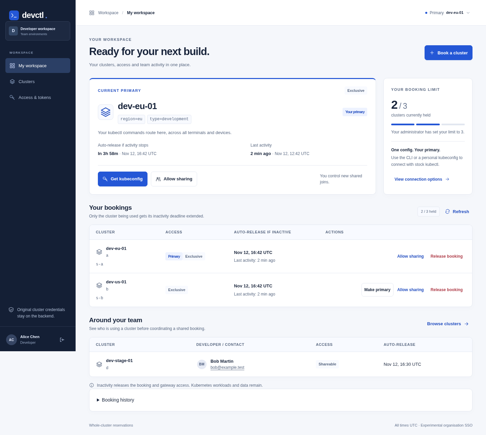

# devctl

A Go backend and developer CLI, with a React and TypeScript browser UI, for reserving existing Kubernetes clusters through an authenticated gateway. PostgreSQL stores reservations, developer limits, primary selections, audit records and encrypted upstream kubeconfigs. Experimental SSO uses OIDC Authorization Code with PKCE and local Keycloak.

Each developer has **one primary cluster** and one stable gateway kubeconfig. Administrators control how many clusters a developer can hold; the default is **one**. After an administrator permits additional bookings, a developer can book more clusters and switch the primary selection without changing or downloading the kubeconfig again.

```text
kubectl + personal gateway credential → /k8s → developer's current primary cluster
                                             no booking → optional PAT label-based booking
```

Original Kubernetes kubeconfigs remain on the backend. The gateway uses the imported identity's existing permissions; it does not create namespaces, change Kubernetes RBAC, install policies, create clusters or delete workloads. A registered kubeconfig can contain cluster-admin privileges. Register only credentials approved for the intended developers. Existing unmanaged credentials can bypass the gateway. See [security and operations](docs/security.md).

## Booking and selection rules

- A new developer inherits the administrator's default maximum, initially **1**. An administrator can set an individual override from 1 through 100, or clear it to inherit the default. Both exclusive and shared bookings count toward the limit across every profile, browser, terminal and device for that SSO identity.
- The first active booking becomes primary. Additional bookings leave the primary unchanged. Select another owned active booking in the UI or with `devctl select CLUSTER_ID`.
- The backend resolves the primary for every Kubernetes request. Switching applies globally. Open watch, exec and port-forward connections to the previous primary are closed after the authorization recheck; operations already accepted by Kubernetes are not rolled back or migrated.
- Stopping or expiring the primary promotes the oldest remaining active booking. With no primary, ordinary CLI access and manual-only PATs return **“no cluster is booked”**. An explicitly opted-in PAT can instead reserve a matching unused cluster on its next Kubernetes request. Login, setup, preference edits, token creation and refresh never allocate.
- Bookings are exclusive by default. Another developer can join only after the controlling holder enables sharing. Sharing permits two holders by default, configurable per cluster from 2 through 10. Participants see names and contact information for manual coordination.
- Only the controlling holder can enable or disable sharing. Disabling sharing blocks new joins without evicting current holders. If the controlling holder leaves, the oldest participant becomes controller and sharing resets to private.
- Bookings remain reserved while that cluster is being used, then auto-release after the administrator’s inactivity period: **4h by default**, configurable from 1m through 168h. Kubernetes requests and authorized open streams, explicit primary selection, and real interaction with the visible browser page count. Only the selected cluster is extended; other held bookings expire independently. Idle tabs, status polling and authentication refresh do not extend bookings.
- Inactivity release works on the backend when clients are closed. It ends gateway access and leaves Kubernetes workloads/data and PATs untouched. Jobs may keep running after the booking is released; coordinate cleanup before another developer uses the cluster. A watch or script can count as activity while unattended, so this is client activity rather than proof of human presence. Lowering a booking limit preserves existing bookings and blocks new ones until the developer is below the limit.
- Unavailable requests fail immediately; this MVP does not queue. Requests with the same idempotency key and parameters return the original booking, including after it ends. Allocation, limits and primary changes use PostgreSQL transaction locks across backend instances.
- Logout releases **all bookings** belonging to that identity and clears the current login, but **does not revoke PATs**. Other developers' bookings and Kubernetes workloads remain.

## Upgrade to inactivity-based reservations

Booking duration and manual renewal have been removed. Omit `--ttl` from `devctl start`; `devctl renew` and the old session-renewal API are retired. Existing active reservations receive one full inactivity grace window during migration, without resetting it on backend restart. The API’s `expires_at` now reports the current auto-release deadline, which moves with qualifying activity. PAT/access-token lifetimes remain independent.

Administrators can update the policy with `devctl admin settings --inactive-grace 4h --reason 'Team inactivity policy'` or in **Administration → People & policy**. Changes apply to current and future bookings; shortening the period may release already-idle reservations. [ADR006](docs/adr-006.md) records the activity rules.

## Upgrade from session-specific kubeconfigs

This version replaces session-specific URLs and fixed automatic bindings. Existing bookings are preserved, and the oldest active booking becomes primary. Existing per-booking PATs are revoked rather than silently granting wider access. Old `/k8s/sessions/...` and `/k8s/auto/...` configs must be replaced once:

- Browser: sign in and download a new personal kubeconfig.
- Full CLI: run `devctl setup` and use its printed path.

After this one-time update, keep the same config across cluster selections and new bookings. Default limits apply to new bookings; users already above the new limit keep their existing reservations. No global `~/.kube/config` is overwritten. [ADR 005](docs/adr-005.md) records this change and supersedes older connection-flow decisions.

## Local setup

Prerequisites: Go 1.26, Node.js 22.12 or later, npm, Docker with Compose, curl and OpenSSL. Integration tests also need kubectl; browser integration uses Python 3 to prepare a disposable realm. Linux is the tested platform. Frontend dependencies are pinned in `frontend/package-lock.json`: React19.3.1, TypeScript7.0.2 and Vite8.3.8. The migration was tested with Node22.20.0 and npm11.19.0.

```bash
cd /repo/devcli
make build
make test
make demo-up
source .demo/env
export PATH="$PWD/bin:$PATH"
```

The backend runs on verified HTTPS **https://127.0.0.1:9090**, Keycloak on **http://127.0.0.1:8081**, and PostgreSQL on **127.0.0.1:54329**. Only the development issuer uses explicitly enabled loopback HTTP. The gateway CA and server certificate are generated under `.demo/tls`; the CLI trusts the public CA through `DEVCTL_API_CA_FILE`.

Development-only accounts:

| Account | Password | Access |
| --- | --- | --- |
| `alice` | `alice-dev-only` | Developer |
| `bob` | `bob-dev-only` | Developer |
| `admin` | `admin-dev-only` | Application administrator |
| `outsider` | `outsider-dev-only` | Rejected |

Keycloak administration uses development bootstrap account `bootstrap-admin` / `bootstrap-dev-only`. For an existing persistent realm, import `deploy/keycloak-web-client.json` under **Clients → Import client** if `devctl-web` is absent. This adds the browser client without recreating users. Its exact callback is `https://127.0.0.1:9090/auth/callback`.

PostgreSQL and Keycloak use separate named volumes. Startup preserves identities, registry data and the encryption key; do not delete volumes to add a client. Keep `.demo` when moving this repository because its saved encryption key is required for the registry. After a move, run `make demo-up` and source `.demo/env` again.

For a remote demo, open this connection from your laptop and keep it open:

```bash
ssh -L 9090:127.0.0.1:9090 \
    -L 8081:127.0.0.1:8081 \
    -L 18000:127.0.0.1:18000 user@SERVER
```

Open the exact **https://127.0.0.1:9090/** address in the laptop browser and trust only the public `.demo/tls/ca.crt`. The browser flow uses ports 9090 and 8081; port 18000 is the CLI loopback callback. In the remote terminal, set `DEVCTL_NO_BROWSER=1`, then open the printed login URL unchanged on the laptop. Use the same browser and host throughout a login. Callback ports support one CLI browser login at a time.

## Frontend development

The browser uses the approved **Slate** design: a light workspace, navy navigation and blue primary actions. The current primary cluster stays visible, booking and personal-config creation use focused drawers, and mobile records retain their controls. Administrators have separate cluster-registry, people/policy, organisation-token and audit views. Confirmation dialogs explain scope and consequences before release, selection or sign-out. [ADR010](docs/adr-010.md) records the implementation.



This screenshot uses isolated test data. The interface reports reservation availability rather than Kubernetes health or capacity.

The frontend source lives in `frontend/src/`: React components for overview, clusters, access/tokens and administration, typed API models and a presence hook. Vite provides the development environment and React Fast Refresh. To edit the UI with live reload, use two terminals:

```bash
# Terminal 1: install pinned dependencies and start Vite on loopback port 5173
make frontend-dev

# Terminal 2: start the backend with its development asset proxy enabled
DEVCTL_FRONTEND_DEV_URL=http://127.0.0.1:5173 make demo-up
```

Open **https://127.0.0.1:9090/**, including when using the SSH tunnel above. Go proxies frontend source and the HMR WebSocket to Vite; authentication, cookies, CSRF, API calls and the Kubernetes gateway retain their existing HTTPS origin. Opening port5173 directly is not the application login flow. The proxy requires a loopback listener, public origin and Vite target. It is disabled unless explicitly configured.

For a different backend development port, copy `frontend/.env.example` to `frontend/.env.local` and set `DEVCTL_FRONTEND_PUBLIC_ORIGIN` to that exact HTTPS origin, then restart Vite. Also update the backend public/listen settings and approved OIDC redirect; the frontend setting alone does not configure them. This variable controls development HMR connection settings, not credentials. Never put tokens, kubeconfigs or secrets in frontend environment variables or `VITE_*` values, which can be visible to browsers.

```bash
make frontend-check  # strict TypeScript and API/label unit tests
make frontend-test   # production build and headless browser regressions
make frontend-build  # regenerate the three embedded production assets
make build           # build frontend first, then Go CLI/backend
```

Headless tests use installed Google Chrome when available, or Playwright Chromium. Install Chromium if necessary with `cd frontend && npm exec playwright install chromium`. The production browser suite verifies the restrictive CSP as well as developer/admin behavior, PAT policies, activity, sign-out and mobile layout.

For normal operation, unset `DEVCTL_FRONTEND_DEV_URL` and run `make demo-up` again. Production serves only the embedded React bundle and retains the strict production CSP; no Vite or Node process is needed at runtime. Generated `internal/webui/assets/` files are tracked so Go-only consumers can still build the checked-in UI with `make backend-build`. Edit TypeScript/CSS source and regenerate these files before committing. The container build also builds the frontend before compiling Go. See [ADR009](docs/adr-009.md).

## Two ways to connect

| Client | Installation | Authentication | Booking controls |
| --- | --- | --- | --- |
| Full CLI | `devctl` | Short-lived access token and refresh token in the OS credential store | Full developer and approved administrator operations |
| Browser | Stock kubectl only | Browser SSO, then one expiring and revocable personal gateway token | UI booking, primary selection and approved administrator operations |

Both use `/k8s` and the same server-side primary selection. The separate kubectl subcommand executable and its installer/package have been removed; full CLI kubeconfigs still use the standard Kubernetes exec credential helper in `devctl`.

### Full CLI

In the server terminal:

```bash
source .demo/env
export PATH="$PWD/bin:$PATH"
export DEVCTL_NO_BROWSER=1  # for a server without a display

devctl login
devctl clusters
devctl start               # book explicitly; the first booking becomes primary
export KUBECONFIG="$(devctl setup)"
kubectl get namespaces

devctl sessions
devctl status BOOKING_ID
devctl share BOOKING_ID    # controlling holder permits sharing
# devctl share BOOKING_ID --off

# After an administrator permits multiple held clusters:
devctl start --cluster OTHER_CLUSTER
devctl select OTHER_CLUSTER
kubectl get namespaces    # same kubeconfig, now using the primary cluster

devctl stop BOOKING_ID
```

`start` also supports `--selector region=eu,type=test`, `--cluster ID_OR_NAME`, and `--idempotency-key KEY`. Reuse the key only with the same parameters when retrying. The CLI prints its generated retry key to stderr. `--json` gives machine-readable results and diagnostics stay on stderr.

`devctl kubeconfig` prints the stable config path without requiring a booking. `devctl exec -- kubectl get namespaces` runs a child with that config without changing the parent shell. `credential` is the exec helper used by kubectl; it emits only a v1 ExecCredential document and refreshes SSO tokens as needed. It never reserves a cluster. Interactive kubectl may request login when no usable login exists; noninteractive commands fail closed and require an explicit login first.

To use the stable path in new shells, explicitly install shell integration:

```bash
devctl shell install --shell bash  # also zsh or fish
# For the current shell:
eval "$(devctl shell init --shell bash)"
```

Primary selection lives on the backend. Different terminals/devices using the same identity therefore share it; use separate SSO identities when independent selections are required. For two local logins, set different `DEVCTL_CONFIG_DIR` values before login (for example `.demo/alice` and `.demo/bob`). Profile isolation does not create independent booking limits or primary selections for the same identity.

### Browser without another executable

Sign in at **https://127.0.0.1:9090/**. Book an available cluster; the first becomes primary. **Access & tokens** can download your personal kubeconfig before or after booking. On the machine where the file is downloaded:

```bash
chmod 600 /path/to/devctl-alice.yaml
export KUBECONFIG=/path/to/devctl-alice.yaml
kubectl get namespaces
```

Switch primary using the overview cards and run kubectl again with that same file. A downloaded PAT is bound to the developer, not to a booking: it remains valid through stopping a booking and booking another, until its own expiry or revocation. Without a booking, a manual-only PAT returns **“no cluster is booked”**. An opted-in PAT can request the limited automatic-booking fallback described below. PATs cannot call control/admin APIs, change an existing primary, edit their preferences or issue other credentials.

PAT lifetime defaults to 8h with a 168h maximum. It does not refresh itself. Authenticated Kubernetes use through the PAT extends only the cluster being used; the PAT’s own expiry never slides. Obtain a replacement through SSO after expiry or revocation. Treat the file as a credential; browser downloads cannot guarantee 0600 permissions. Revoking the PAT ends that credential's gateway requests and streams but leaves bookings intact. Logout releases all bookings but preserves PATs. The same valid PAT works again after another booking; an opted-in PAT can create that booking on a later gateway request. Logout does not disable automatic booking or extend the PAT expiry. Revoke a PAT explicitly when it is no longer wanted.

The full CLI can also manage native-kubectl credentials:

```bash
devctl token create --name laptop --ttl 8h  # prints only a new private file path
devctl token list
devctl token create --name tests --auto-book --selector region=eu,environment=testing
devctl token update PAT_ID --selector region=us,environment=development
devctl token update PAT_ID --auto-book=false
devctl token update PAT_ID --clear-selector  # keep the enabled setting; match any unused cluster
devctl token revoke PAT_ID
```

Existing configurations authored by the removed standalone client must be replaced once: run `devctl setup` with the full CLI and use its printed path, or download a browser PAT config. Existing PAT kubeconfigs already use stock kubectl and remain valid. No installed user executables or shell startup files are removed automatically.

## Optional automatic booking with a PAT

In **Access & tokens**, enable automatic booking when creating a credential and enter equality labels such as `region=eu,environment=testing`. Alternatively use `devctl token create --auto-book --selector region=eu,environment=testing`. Store the printed kubeconfig path privately and use ordinary kubectl. No extra local executable is required for a PAT configuration.

If the owner already has a primary, the gateway uses it regardless of this PAT’s selector. Otherwise an enabled, valid PAT transactionally reserves the first unused, nonmaintenance registered cluster matching every saved label, makes it primary and forwards the request. It never joins another developer’s shared booking automatically. Unused means no active devctl reservation; the backend does not inspect or remove Kubernetes workloads left behind. An empty selector permits any unused cluster. No matching capacity returns an actionable kubectl error; there is no queue, cluster creation or fallback outside the selector. Concurrent first requests share one reservation across backend instances. Administrator booking limits and normal inactivity expiry still apply.

Use **Access & tokens → Your personal tokens → Edit policy** or `devctl token update PAT_ID` to change the enabled setting or replace/clear the selector. Changes are saved server-side and apply to the next allocation. The PAT ID, token, expiry and downloaded kubeconfig stay unchanged, and an existing primary is not switched or released. Owners edit their own records through SSO; administrators can edit another developer’s record with an audit reason (`--reason` in the CLI). Expired/revoked credentials cannot be edited. The same PAT cannot authenticate to its control endpoint.

Automatic booking is off for existing and newly issued PATs unless explicitly enabled. A valid enabled PAT can book again after stop, inactivity expiry or logout on a later Kubernetes request; disable its automatic-booking setting or revoke it to prevent that capability. Already open streams for the ended booking close normally and are never migrated. The separate kubectl subcommand client has been removed; use the full CLI or browser. [ADR008](docs/adr-008.md) records the decision.

## Administration

Sign in as `admin`; administrator navigation appears in the sidebar and on mobile. Use **Cluster registry**, **People & policy**, **Organisation tokens** or **Audit log** for the corresponding task. Administrators can:

- Set the default maximum held clusters, initially one, and the release-after-inactivity period, initially four hours, with an audit reason.
- Set a developer override or clear it to inherit the default. The view shows held counts, effective limits and primary selections. Developers appear after their first application login.
- Register an approved static kubeconfig, which is encrypted before storage. Registration and booking do not contact or modify Kubernetes.
- Enable/disable maintenance, release bookings and revoke another user's PAT with an audit reason.
- Deregister an unused cluster from **Administration → Cluster registry** or the CLI. Supply an audit reason and confirm removal in the browser. Active bookings block deregistration; release them first.
- Inspect allocation and administration audit records. Credential values are never displayed.

Search and filters operate on data already loaded in the current view. Audit filtering covers the latest100 returned events, rather than a server-side search of the complete history. Forms retain entered values after recoverable errors, and an unchanged booking retry retains its idempotency key.

Lower booking-count limits never evict holders. Inactivity-period changes update current deadlines from their last activity; shortening the period can release idle bookings. Maintenance blocks new placement without ending current reservations. Administrative release updates primary selection using the same safe application state path as owner release; no Kubernetes workloads are removed.

```bash
devctl admin settings
devctl admin settings --max-bookings 2 --reason 'Permit two environments'
devctl admin settings --inactive-grace 4h --reason 'Release clusters four hours after activity stops'
devctl admin developers
devctl admin limit OWNER_ID --max-bookings 3 --reason 'Integration testing'
devctl admin limit OWNER_ID --reset --reason 'Use the team default'

devctl admin maintenance CLUSTER_ID --reason 'Planned maintenance'
devctl admin maintenance CLUSTER_ID --enabled=false --reason 'Maintenance complete'
devctl admin release BOOKING_ID --reason 'Owner requested release'
devctl admin deregister CLUSTER_ID --reason 'Retiring environment'
```

Deregistration removes the stored kubeconfig and hides the cluster from booking/availability lists. Historical bookings, idempotency keys and audit events retain archived public metadata. Repeating the command is safe. Retired IDs cannot be reused; register again with a new ID (the display name may be reused). No Kubernetes request is made, workloads remain, and PATs keep their independent validity. Database backups may still contain previous encrypted credentials until their retention period ends. [ADR007](docs/adr-007.md) records this choice.

## Packaging and tests

```bash
make client-package       # dist/devctl-client-<os>-<arch>.tar.gz
```

The archive contains one executable and `install.sh`. Supply approved API/issuer URLs and optional public CA:

```bash
./install.sh --api https://devctl.example.test \
  --issuer https://identity.example.test/realms/engineering \
  --ca-file /path/to/public-gateway-ca.pem --shell bash
```

The installer defaults to `~/.local/bin` and only edits a shell startup file when `--shell` is explicitly supplied. Omit it to receive the current-terminal command. Native Linux packages/installers are tested; other platforms need deployment validation. Installers perform setup, not booking.

```bash
make test                 # unit/race tests; unconfigured real-service suites skip
make test-db              # PostgreSQL-backed reservation, API and browser tests
make demo-test            # real Keycloak, CLI/backend, local TLS API fixtures
make browser-test         # isolated Keycloak browser/PAT/native kubectl test
```

Run `make demo-up` first. Tests use uniquely named PostgreSQL schemas and disposable TLS Kubernetes API fixtures, not registered remote clusters. Browser tests use a disposable Keycloak instance on port 18081 and test gateway on 19090, removed afterward. These fixtures verify API routing and transport, not real-cluster admission, CNI or workload behavior. Exact executed checks and deployment gaps are recorded in [verification](docs/verification.md).

`make demo-down` deletes this project's demo databases, identities, encryption key and private backups. Use `docker compose stop` to pause while preserving data. Other Docker projects and real clusters are untouched.

## Configuration and operations

| Backend variable | Meaning |
| --- | --- |
| `DATABASE_URL` | PostgreSQL URL; verified TLS outside the demo |
| `DEVCTL_MASTER_KEY` | Base64 encoding of 32 random bytes, kept outside the database |
| `DEVCTL_LISTEN` | Default `127.0.0.1:9090` |
| `DEVCTL_PUBLIC_URL` | Exact public HTTPS origin used in the one stable gateway URL |
| `DEVCTL_GATEWAY_CA_FILE` | Optional public PEM trust bundle; no private keys |
| `DEVCTL_GATEWAY_RECHECK_INTERVAL` | Default `1s`, range `100ms` through `30s`; checks time out after `5s` |
| `DEVCTL_TLS_CERT`, `DEVCTL_TLS_KEY` | HTTPS listener certificate/key |
| `DEVCTL_ISSUER`, `DEVCTL_OIDC_CONFIG` | Trusted discovery, API audience, scopes and claim mappings |
| `DEVCTL_WEB_CLIENT_ID` | Browser OIDC client, default `devctl-web` |
| `DEVCTL_WEB_CLIENT_SECRET` | Optional confidential web-client secret; backend only |
| `DEVCTL_WEB_SESSION_TTL` | Browser absolute lifetime, default `8h`, range `1m` through `168h` |
| `DEVCTL_FRONTEND_DEV_URL` | Optional loopback Vite origin, e.g. `http://127.0.0.1:5173`; development only, unset in production |
| `DEVCTL_DEV_HTTP=1` | Development-only loopback HTTP issuer allowance |

The reservation inactivity period is a durable administrator setting, not a token lifetime or environment variable. `devctl admin settings` displays `inactivity_grace_period` and the default booking count. Reservation activity and expiry are persisted in PostgreSQL; backend restarts resume expiry checks.

Clients use `DEVCTL_API`, `DEVCTL_API_CA_FILE`, `DEVCTL_CONFIG_DIR` and optionally `DEVCTL_NO_BROWSER=1`. Authentication uses the OS credential store by default; `DEVCTL_DEV_TOKEN_FILE=1` explicitly enables the demo's private0600-file fallback. Never log tokens, cookies, exec credential output or original kubeconfig contents.

Developers need network access to the gateway and IdP; the backend must reach the IdP and registered Kubernetes endpoints, possibly through a VPN. Run the backend outside the clusters it reserves. Both gateway and upstream Kubernetes TLS are verified. Proxies must support long-running responses, WebSocket/SPDY upgrades and the configured public host. Use private CA trust instead of bypassing verification.

Corporate OIDC, desktop keyrings, production proxies/load and real-cluster workload behavior require deployment validation. Cluster permission isolation, resource accounting, queueing, automatic cleanup, upstream credential rotation, SAML and opaque provider access tokens remain deferred. The gateway's own opaque PATs are supported separately. See [security](docs/security.md), [organisation SSO checklist](docs/organisation-sso.md), [ADR005](docs/adr-005.md), [ADR006](docs/adr-006.md) and [OpenAPI](docs/openapi.json).
