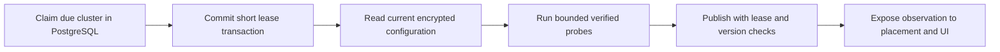

# Cluster health checks: architecture and implementation plan

Status: core health monitoring implemented on 2026-11-17 from this design, originally based on repository commit `bd7136c`. See the implementation boundary below and the [verification record](verification.md) for executed checks. Examples use fictional identifiers. This document does not authorize changes to registered clusters or corporate identity systems.

The first release includes migration 9, durable Disabled/Observe/Enforce modes (default Disabled), fixed GET-only probes, leased workers, generation-fenced publication, fresh-health placement gates, GUI/CLI controls and automated TLS/PostgreSQL/browser integration tests. API paths and CLI commands described below are implemented. Timing defaults are constants rather than administrator-editable settings, and concurrency is capped at four per backend instance with one database lease per cluster. Migration 10 adds simple lifecycle webhooks: successful completion invalidates old health claims and requires two post-callback passing cycles before resolving a hold. Serial blocking work reuses the existing health recovery counter with a per-delivery sequence/time barrier. Machine credential replacement, identity reviews, heterogeneous egress domains, metrics exporters and configurable history retention remain future integrations. The later design sections retain their proposed requirements for that future work; they are not a claim those integrations exist.

## 1. Recommended approach

Add a small background health worker to the existing Go backend. Probe each registered Kubernetes API from the same network and trust environment that the gateway uses, using its existing server-held credentials. Persist bounded observations in PostgreSQL and require a fresh passing observation before admitting a **new** booking.

Keep three independent decisions:

1. **Reservation:** is there developer capacity, including explicit sharing consent?
2. **Administrative control:** is placement enabled, with no unresolved automation holds?
3. **Health:** did this connection configuration recently pass its configured checks?

All must permit placement. A successful probe cannot clear maintenance or a workflow hold. A failed probe cannot end a booking, select another primary, revoke a PAT or terminate an authorized stream. Existing reservation expiry still operates normally. See the companion [lifecycle automation proposal](lifecycle-automations-architecture.md) for automation holds.

Use the current Go, PostgreSQL and client-go stack. No agent in each cluster, additional service, Redis, Prometheus installation or Kubernetes resource creation is needed for the initial version.

## 2. Original baseline and integration points

| Code | Current behavior | Required change |
| --- | --- | --- |
| [`internal/api/server.go`](../internal/api/server.go) | `/healthz` answers locally; `/readyz` checks PostgreSQL | Preserve application probes; expose cluster observations separately |
| [`internal/model/model.go`](../internal/model/model.go) | Cluster metadata has maintenance, participants and reservation availability | Add an observation summary and separate placement eligibility |
| [`internal/store/deregister.go`](../internal/store/deregister.go), `populateCluster` | Calculates availability from reservations and maintenance | Include the common eligibility decision, without changing reservation counts |
| [`internal/scheduler/scheduler.go`](../internal/scheduler/scheduler.go), `Pick` | Chooses compatible clusters in stable order | Skip candidates whose health fails the placement policy |
| [`internal/store/store.go`](../internal/store/store.go), `Tx.book` | Locks reservation mutations and handles idempotency | Revalidate health in the transaction that creates a booking |
| [`internal/store/pat_booking.go`](../internal/store/pat_booking.go), `autoBookPAT` | Has its own unused-cluster candidate loop | Skip unhealthy candidates and continue to later healthy candidates |
| [`internal/kube/config.go`](../internal/kube/config.go) | Validates static configs and decrypts them server-side | Reuse validation/vault; do not distribute plaintext configs |
| [`internal/api/gateway.go`](../internal/api/gateway.go) | Builds a verified authenticated upstream transport and classifies failures | Share transport-building conventions, not reservation/activity code |
| [`cmd/devctld/main.go`](../cmd/devctld/main.go) | Starts API, gateway and periodic expiry work | Start the health worker under process cancellation |
| [`frontend/src/types.ts`](../frontend/src/types.ts), [`frontend/src/pages/Clusters.tsx`](../frontend/src/pages/Clusters.tsx), [`frontend/src/pages/Admin.tsx`](../frontend/src/pages/Admin.tsx) | Show reservation and maintenance state | Display health separately and disable new booking actions consistently |

The recent gateway diagnostics established why reservation availability alone is insufficient: an unreserved API endpoint can still time out or fail CA verification. Those observations were point-in-time diagnostics, not a durable health service. Do not copy them into initial migration data as permanent verdicts.

## 3. Define the assurance explicitly

Health means **the configured API checks passed from the backend**, not that every workload will run. It does not prove node capacity, scheduler fit, storage, application readiness, all CRDs, network isolation, or unrestricted permissions.

Start with two fixed, versioned profiles. Administrators select a profile; they cannot supply arbitrary HTTP paths, scripts, credentials or response expressions.

| Profile | Required checks | UI description |
| --- | --- | --- |
| `api-ready.v1` — default | Verified TLS, `/version`, `/api`, `/apis`, `/readyz`, and the discovery validation below | API checks passing; readiness confirmed |
| `discovery-only.v1` — explicit exception | The same checks except `/readyz` | API reachable; readiness not checked |

Use `/readyz` for API readiness, not the deprecated Kubernetes `/healthz`. Judge readiness by its HTTP status rather than parsing verbose diagnostic text. A 403 means the imported identity lacks permission for that check; it does not establish that Kubernetes is down. Do not silently downgrade the profile when that happens. An administrator can arrange the narrowly required access outside devctl or deliberately select the lower-assurance profile with an audit reason. These endpoint semantics are documented in the [Kubernetes health-check reference](https://kubernetes.io/docs/reference/using-api/health-checks/).

### Fixed probe sequence

1. Validate the stored kubeconfig and construct the same authenticated, CA-verified transport used for forwarding.
2. GET `/version`; require HTTP 200 and a structurally valid Kubernetes version response.
3. GET `/readyz` when required; require HTTP 200. Do not collect `?verbose` output by default.
4. GET `/api` and `/apis`; request aggregated discovery v2 with ordinary JSON as the compatibility fallback. Validate the negotiated response type and body structure.
5. If aggregated discovery is returned, inspect group-version freshness. Required stale discovery makes the cycle fail; report `discovery_stale`, not a healthy response merely because HTTP was 200. For the conservative default profile, treat any explicitly stale advertised group-version as a failed discovery check.
6. With legacy discovery, additionally check `/api/v1`, `/apis/apps/v1` and `/apis/batch/v1` as the fixed baseline for ordinary application and Job discovery. Record `discovery_coverage=baseline`; do not claim every advertised extension API was checked. Bound the cycle to seven requests and never expand into an unbounded scan of every group/version.

The `/api` and `/apis` endpoints publish discovery, and response negotiation determines whether discovery is aggregated. Use client-go's existing discovery types/decoding rather than inventing another parser. A valid legacy group list does not prove that every downstream API service works. See the [Kubernetes Discovery API](https://kubernetes.io/docs/concepts/overview/kubernetes-api/#discovery-api).

### Authentication and permissions limits

Send the actual registered identity, including its client certificate or static bearer token, and classify 401/403 responses. However, GET success at publicly accessible endpoints does not prove which identity was authenticated. Record `identity_verification=NOT_CHECKED`; never present this profile as a workload-permission audit.

An optional future identity check could use a fixed `SelfSubjectReview`. It is an HTTP POST, even though it does not install a workload or persist a normal application object, so it must be a separately approved capability rather than a hidden part of GET-only monitoring. `SelfSubjectAccessReview` answers a permission question and is not a substitute for identity verification. The distinction and anonymous access behavior are covered by the [Kubernetes authentication reference](https://kubernetes.io/docs/reference/access-authn-authz/authentication/).

The default monitor requires existing GET access to its fixed non-resource endpoints and, for legacy discovery, the baseline discovery URLs. It does not create RBAC bindings, namespaces, ServiceAccounts, Pods, Jobs or temporary test resources. Do not request cluster-admin to make health checks pass. Protected application operations still depend on the imported credential's real permissions.

## 4. Transport, deadlines and load

Use `kube.Validate`, `clientcmd.RESTConfigFromKubeConfig` and the official authenticated transport. Keep decrypted data only in worker memory. Retain certificate authority validation, TLS server-name overrides and inherited proxy behavior; executable credential plugins remain unsupported.

Preserve the configured endpoint path prefix. A registered URL such as `https://api.example.test/clusters/lab-a` must be probed at `/clusters/lab-a/readyz`. Resolving an absolute `/readyz` reference can accidentally discard that prefix. Use the same validated path-append behavior as the gateway, including escaped paths. Disable redirects so credentials cannot follow an unexpected location.

Use a dedicated health HTTP client and per-probe contexts. Do not change the gateway's transport deadlines or impose an overall timeout on watches, logs, exec or port-forward. Never invoke `kubectl` as a subprocess or use developer browser/PAT/exec-plugin credentials to probe.

Proposed defaults, to validate with disposable fixtures before enabling enforcement:

| Setting | Default and rationale |
| --- | --- |
| Check interval | 30 seconds, with bounded ±20% jitter to avoid synchronized bursts |
| Maximum observation age | 90 seconds from the completed cycle, evaluated using database UTC time |
| Per-request deadline | 3 seconds, including body consumption |
| Entire cycle deadline | 10 seconds; remaining requests inherit the remaining budget |
| Probe lease | 20 seconds; publishing must finish before its lease expires |
| Worker concurrency | At most four clusters per backend instance; one leased cycle per cluster across instances |
| Failure policy | First failed required check blocks new placement immediately |
| Recovery policy | Two consecutive passing cycles, including initial observation/registration |
| Body limits | 64 KiB version, 4 KiB readiness, 4 MiB per discovery response, capped after decompression |
| Administrator refresh | Coalesced, at most one requested refresh per cluster per 10 seconds |

Stop a cycle at its first failed required check. Use no immediate HTTP retries inside a cycle: the next scheduled cycle is the retry. Honor rate-limit backoff, bounded to five minutes; the result becomes stale normally during longer backoff. Exceeding a body limit is a failed check, never a truncated JSON success.

Only a named administrator-approved profile revision can change check requirements. Operator changes to intervals, maximum age or failure policy are bounded, audited and revisioned; they must not silently reinterpret an old observation as newly passing. Keep the scheduling interval and freshness threshold coherent. Emit alerts after repeated failures if desired, separately from the immediate conservative placement decision.

## 5. Durable state and derived eligibility

Add a migration after the currently recorded schema version, following the repository's existing migration conventions. The following is a logical schema, not a ready-to-apply migration:

| Record | Fields |
| --- | --- |
| `clusters` additions | `configuration_generation`, `health_profile`, `health_policy_revision` |
| `cluster_health` — one current row per registered cluster | `cluster_id`, observed config/policy versions, `observed_state`, fixed `reason_code`, safe summary, component outcomes, discovery coverage, `identity_verification`, start/end/success/failure timestamps, duration, consecutive successes/failures, next due time |
| Health claim fields on that row | Monotonic `probe_sequence`, random `lease_token`, `lease_until`, claimed config/policy versions |
| Optional bounded history | Transition summaries and a retained sample of probe results; no response bodies, headers, plaintext configs or credentials |

Add an index for due time and lease expiry. Encrypt credentials through the existing vault; do not duplicate them in health/history tables.

Use these effective states:

| State | Meaning | New placement |
| --- | --- | --- |
| `UNKNOWN` | No accepted result for the current configuration/profile | Blocked |
| `RECOVERING` | Required checks passed, but two consecutive successful cycles have not completed | Blocked |
| `PASSING` | Current profile passed and recovery threshold was met | Allowed only while fresh and all other gates pass |
| `FAILING` | Latest accepted cycle failed a required check | Blocked immediately |
| `STALE` | Last accepted cycle exceeded maximum age | Blocked |

`STALE` is derived at read/allocation time, even if no worker runs. A stored `PASSING` must never remain eligible indefinitely. Preserve the last failure and last successful observation for diagnosis. A queued/running check does not reset observation timestamps or make a previous failure pass. Application/worker startup must not refresh results without an actual accepted cycle. Reset the consecutive-success counter after a failure, configuration/policy change or observation gap exceeding maximum age; the first success after a stale interval is `RECOVERING`, even if an old stored counter was high.

Credential, endpoint, CA, TLS-name or identity changes increment `configuration_generation`, invalidate health to `UNKNOWN` and schedule a new check atomically. Profile changes increment `health_policy_revision` and do the same. Label edits and manual maintenance do not normally invalidate connectivity observations. Deregistration invalidates/cancels claims and excludes the row from all new work.

Define one shared predicate, using a UTC timestamp obtained from PostgreSQL inside the transaction:

```text
health_eligible(cluster, observation, now) =
    observation matches current configuration_generation and health_policy_revision
    AND observation.state == PASSING
    AND observation.completed_at <= now
    AND now - observation.completed_at < maximum_observation_age

placement_eligible(cluster, request, now) =
    cluster is registered
    AND labels/name match request
    AND manual maintenance is off
    AND there are no unresolved automation holds
    AND health_eligible(cluster, observation, now)
    AND reservation/sharing capacity permits this developer
```

A probe is an observation, not a guarantee for the next request. Kubernetes can fail immediately after a fresh pass; normal gateway errors still apply.

## 6. Worker algorithm and concurrency



1. Claim a small due batch using row locks with `FOR UPDATE SKIP LOCKED`. Increment the probe sequence, assign a random token and a database-derived lease expiry, then commit. PostgreSQL documents this locking option for queue-like consumers in its [SELECT reference](https://www.postgresql.org/docs/current/sql-select.html#SQL-FOR-UPDATE-SHARE).
2. Read the registered encrypted configuration and its generation. If it no longer matches the claim, abandon that claim safely and arrange a check for the new version. Decrypt and perform HTTP outside every database transaction.
3. Publish through a short transaction using the existing reservation advisory lock, then the health-row lock. Require current lease token, sequence, unexpired lease, registration, config generation and policy revision to match. Discard late/stale results. A pre-update probe cannot make a replacement endpoint look healthy.
4. Update result, success/failure counters and next due time together; release the claim and record meaningful transitions. Schedule the next cycle from completion plus jitter, avoiding catch-up floods after restart.
5. Reclaim expired leases after crashes. A former owner cannot overwrite a newer result. Graceful shutdown cancels probe contexts; cancellation is not a successful observation. Let an uncompleted claim expire rather than publishing a false network failure caused by shutdown.

Keep lock order consistent: publishing/booking/registration use advisory lock before health-row locks. Claiming may hold only its short queue-row locks and must never retain them while waiting for the advisory lock, calling HTTP or acquiring a conflicting cluster lock. Use conditional updates for claim release so a late worker cannot release its successor's lease.

All backend replicas may work from the same durable queue only when they share equivalent cluster connectivity and trust. If gateway replicas run in different VPN/network domains, a pass from one cannot validate another. Initially require one egress domain; before supporting heterogeneous deployments, key observations by connection domain and route gateways/placement to the matching domain. Never publish a globally optimistic verdict from the one replica that happens to connect.

## 7. Integration with reservations and the gateway

Apply the common predicate to both the scheduler and the PAT candidate loop. Update `Tx.book` to recheck the latest observation under the same lock as allocation and health publication. Do not do HTTP while selecting a cluster. If the first otherwise compatible candidate is failing/stale, automatic selection continues to later eligible clusters in stable ID order.

Preserve booking idempotency: replaying an existing successful key returns that recorded booking, including its current lifecycle state. It does not create a new reservation, require a new healthy cluster or redirect the developer. Health checks apply when creating a reservation, including joining an explicitly shared cluster.

An expected health/capacity rejection must not accidentally roll back valid inactivity expiry and any resulting lifecycle event/hold already applied in the same request. Separate the domain result from the transaction error, as the PAT path already does for selected allocation failures: commit valid housekeeping, then return the booking rejection. Storage or invariant failures still roll back. Cover this distinction in manual booking, PAT fallback and primary-resolution entry points.

Keep an existing primary pinned. A failed background check must not cause automatic fallback, silent switching, eviction, quota changes or credential revocation. Existing gateway requests should attempt their real operation and use normal sanitized error handling; a stale monitoring result must not become a second access-control system. A deliberate lifecycle hold or release has its own separate access/drain rules.

Health probes bypass `PrimaryConfig`, `PrimaryPATConfig`, `RecordPrimaryActivity`, browser presence and gateway middleware. They cannot create a booking, renew its inactivity deadline, update PAT last-use times, repair a primary or appear as a developer's activity. Use dedicated store methods that do not call `Tx.expire` or produce implicit reservation side effects.

For failed placement, return a stable reason such as `cluster_health_unavailable` with safe candidate details and last-observation time. Keep explicit booking conflicts consistent with the existing HTTP 409 contract. Native kubectl/PAT fallback must preserve an actionable text response and skip unhealthy candidates; do not reintroduce JSON errors that become `InternalError("unknown")`. There is still no queue or automatic migration in this proposal.

## 8. REST API, CLI and GUI

Extend the protected cluster summary with safe fields such as:

```json
{
  "id": "cluster-lab-a",
  "available": false,
  "reason": "new bookings blocked: Kubernetes API connection timed out",
  "health": {
    "state": "FAILING",
    "profile": "api-ready.v1",
    "reason_code": "connect_timeout",
    "checked_at": "2026-11-17T10:00:00Z",
    "last_success_at": "2026-11-17T09:59:30Z",
    "max_age_seconds": 90,
    "duration_ms": 3000,
    "readiness_confirmed": false,
    "discovery_coverage": "not_completed",
    "identity_verification": "NOT_CHECKED"
  }
}
```

Implemented health APIs:

- `GET /v1/clusters/{id}/health`: authenticated team-visible safe status; no network request or reservation side effects.
- `POST /v1/admin/clusters/{id}/health-check`: authenticated administrator queues/coalesces a fixed check, returning 202 and a pollable request identifier. Enforce browser Origin/CSRF, rate limits and an audit reason. Do not hold the response open for upstream HTTP.
- Extend the existing admin cluster PATCH with profile selection, expected policy revision and an audit reason. Do not offer a force-healthy field or arbitrary URL/path input.

The full CLI could expose `devctl admin cluster check CLUSTER_ID` and `--wait`/`--json` after following existing command conventions. Waiting is optional; request acceptance is not a passing result. Extend `devctl clusters --json` and its table with health/observation age without printing upstream endpoints. Proposed spellings require CLI implementation and help tests; they are not current commands.

In the Slate UI, give Health, Reservation and Maintenance their own labels. Show checked-at age, safe failure category and profile coverage in a focused detail view. Use text/icons as well as color, retain keyboard/mobile behavior, and disable new booking actions with the same reason enforced by the server. Keep release/select/contact controls available to current holders. An admin refresh shows queued/running state without replacing the previous result with a green indicator. Paginated history and component timings belong in admin detail, not every cluster card.

## 9. Failure handling, security and operations

Use fixed reason codes such as `dns_failed`, `connect_timeout`, `connection_refused`, `tls_untrusted`, `tls_expired`, `unauthorized`, `permission_blocked`, `api_not_ready`, `discovery_invalid`, `discovery_stale`, `response_too_large` and `rate_limited`. Preserve safe per-component status and timing. Do not log raw errors, URLs, queries, bodies, certificates, token headers or kubeconfig text. Authentication usernames from a future identity check are admin-only unless deliberately exposed.

Only the trusted registration supplies the destination. Limit probes to the approved Kubernetes endpoint and fixed suffixes; apply deployment egress policy and the same registration trust controls as gateway forwarding. Do not introduce a public URL-probing API. Never disable CA or hostname verification to make a red indicator green.

Record health **transitions** and administrator actions, not every passing cycle, in the audit trail. If event subscriptions are implemented, emit versioned transitions through their transaction/outbox helper and exclude self-triggering probe/delivery loops. Health failure itself must never automatically start a destructive pipeline. A successful pipeline callback likewise does not synthesize a passing health result.

When a workflow enters `VERIFYING`, persist a verification barrier under the shared transaction lock: database time, current configuration/policy versions and a minimum future probe sequence. Its hold can be resolved only by a passing observation from a cycle that **started after that barrier**, with matching versions and the required recovery policy. Count the required consecutive passes after this barrier for the workflow; do not reuse a pre-barrier success counter. A reinstall can leave the endpoint and credentials unchanged; an earlier green result or a still-running pre-callback probe is insufficient. Later credential changes advance the barrier and invalidate prior results. Ordinary administrator refresh requests may coalesce, but workflow verification must arrange a genuinely post-barrier cycle rather than attach to an older in-flight check. Each sequential workflow uses its own verification barrier.

Suggested metrics are counts by effective state/reason, queue lag, probe durations, accepted/discarded results and lease reclamations. Avoid developer IDs, raw endpoint URLs and token IDs as metric labels. Retain detailed samples for a bounded period, for example seven days; preserve separately configured audit retention.

Do not make one remote cluster outage fail devctl's own `/readyz` or `/healthz`: the service must remain available to show failures and release bookings. Report worker lag through protected diagnostics and monitoring. A dead worker causes observations to become stale and new placement to stop, while application health continues to describe the application.

## 10. Implementation and verification sequence

1. Add model/schema and a pure eligibility function with deterministic UTC time inputs. Backfill `UNKNOWN`; do not mark existing clusters passing.
2. Add the fixed probe client and local TLS fixture tests. Add queue claiming, versioned publication and crash recovery with PostgreSQL-backed concurrency tests.
3. Run in explicit observe-only rollout mode: expose truthful observations, retain current placement behavior and display that health enforcement is not yet enabled. Do not describe those clusters as health-validated for allocation.
4. Enable enforcement in both manual and PAT paths after observations and permissions are reviewed. New registrations remain blocked until recovery requirements pass; existing bookings remain intact. Enforcement must be consistent across replicas.
5. Add safe API/CLI/UI inspection and refresh, OpenAPI/error contracts, operational monitoring and the profile-change workflow. Integration tests exercise the same predicate as server-side placement.

Required tests before claiming the feature works:

| Layer | Acceptance evidence |
| --- | --- |
| Probe fixtures | Valid readiness/discovery; TCP/DNS/TLS failures; wrong CA/expired certificate; 401/403; readiness failure; HTTP 200 HTML; malformed/oversized/gzip bodies; stale aggregated discovery; legacy baseline discovery; endpoint prefix and redirect handling |
| Deterministic policy | Unknown, first failure, two-success recovery, exact staleness boundary, recovery-counter reset after a long gap, configuration/profile mismatch, maintenance and every automation hold |
| Real PostgreSQL | Multiple workers, short leases, dead worker, stale result after replacement/deregistration, consistent lock order, health failure racing allocation, unhealthy-first PAT skipping, idempotent replay; unchanged-config workflow completion cannot reuse old green or pre-barrier in-flight results |
| Existing access | Health traffic leaves booking deadlines, primary, PAT last-use/expiry and developer activity unchanged; existing watches/exec stay pinned and open across background health failure; normal release still closes them |
| API/UI/CLI | Safe status, pending refresh, rate limit, no forced green, denied non-admin mutation, accessibility and native kubectl actionable errors |
| Disposable Kubernetes, separately authorized | GET-only profiles with sufficient/insufficient endpoint access, aggregated/legacy behavior and actual gateway workload compatibility; no RBAC/resources automatically installed by monitoring |

Use local TLS protocol fixtures plus disposable PostgreSQL schemas for failure and race coverage. Real Kubernetes checks need separately approved disposable targets; existing remote registrations must not become integration-test infrastructure implicitly. Neither architecture document constitutes permission to probe or mutate corporate systems.

The implementation follows this plan for core monitoring and opt-in placement enforcement. Automated tests use local TLS fixtures, isolated PostgreSQL schemas, the actual backend/worker, native Kubernetes clients and local Keycloak; they do not establish real-cluster workload compatibility or production-network behavior. Monitoring remains disabled on upgrade until an administrator enables it for approved targets. Real-cluster integration, operational tuning, production rollout and the future integrations identified above require separate validation; current results are recorded in [verification](verification.md).
